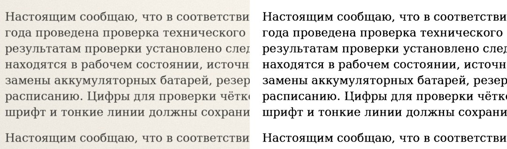

# JpegToPdf

Прототип: сканы документов в JPEG → компактный PDF с JBIG2.



## Состав
- `core/jbig2_generic.c` — собственный кодер JBIG2 (generic region, MQ-арифметика, шаблон 0, TPGDON). Только libc, без сторонних библиотек. Этот же файл пойдёт в Android через dart:ffi.
- `scan2pdf.py` — бинаризация Sauvola, сборка JBIG2-сегментов, минимальный PDF-писатель.
- `tools/make_test_scan.py` — синтетический тестовый скан A4 300 dpi (`samples/test_scan.jpg`).

## Запуск
```
pip install numpy pillow
python3 scan2pdf.py out.pdf samples/test_scan.jpg --save-bitmaps out/bitmaps
```
Ядро на C собирается автоматически (`gcc -O2 -shared -fPIC`).

## Что без потерь, а что нет
- Кодирование JBIG2 — строго без потерь: декодер poppler восстанавливает ч/б страницу бит в бит (проверено, 0 отличий).
- Бинаризация — единственный шаг с потерей: серый и цвет становятся чёрно-белыми. Для страниц с печатями и фото нужен режим MRC (следующий этап).
- Символьный режим JBIG2 (подстановка похожих букв) не используется.

## Результат на тестовом скане (A4, 300 dpi, JPEG q=90)
| Вариант | Размер |
|---|---|
| JPEG как есть в PDF (img2pdf) | 2 233 КБ |
| CCITT G4 (img2pdf) | 51 КБ |
| JBIG2 (этот прототип) | 32 КБ — ×68 |

## Дальше
1. Проверить на настоящих сканах, подобрать `--k` и окно Sauvola.
2. Перенести бинаризацию в C, подключить ядро к Flutter через dart:ffi.
3. Определять цветные страницы и кодировать их через MRC.
